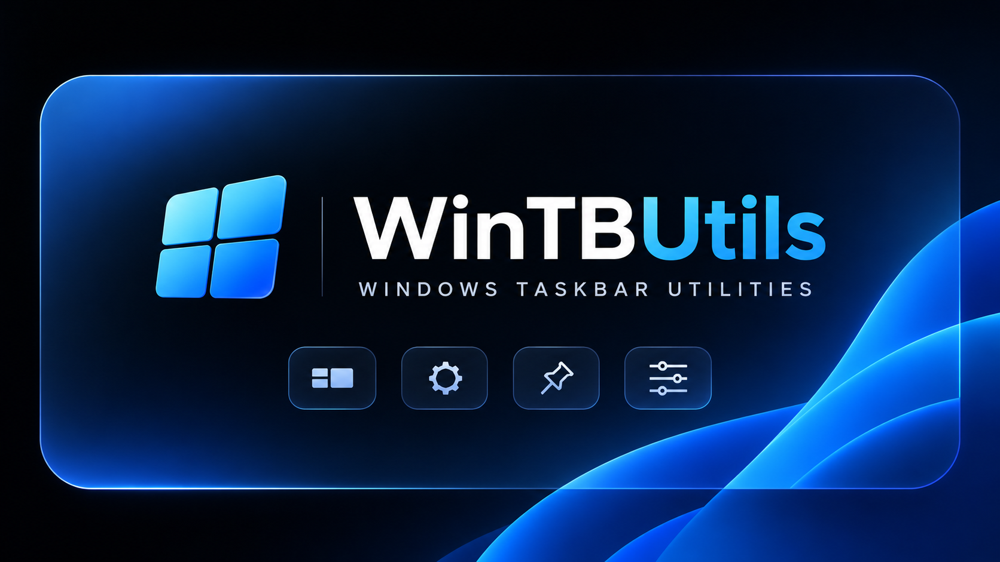

<div align="center">



<h1>WinTBUtils</h1>

<p>Small command-line utilities for the Windows 11 taskbar.</p>

[](https://github.com/SilentDemonSD/WinTBUtils/releases/latest) [](https://github.com/SilentDemonSD/WinTBUtils/actions/workflows/build.yml) [](LICENSE)   

[Install](#install) · [Usage](#usage) · [Before you use it](#before-you-use-it) · [Troubleshooting](#troubleshooting) · [Contributing](#contributing)

</div>

## Overview

The first utility makes the taskbar fully transparent and keeps it that way through Explorer restarts and display changes. It needs no admin rights and no background app beyond one tiny watcher process.

## Install

Run this in PowerShell:

```powershell
irm https://raw.githubusercontent.com/SilentDemonSD/WinTBUtils/main/install.ps1 | iex
```

This downloads the latest release to `%LOCALAPPDATA%\WinTBUtils` and adds it to your user `PATH`. It changes nothing on the taskbar until you run a command.

> [!TIP]
> Run the same command again to upgrade.

## Uninstall

```powershell
tbutil uninstall
```

This restores the taskbar, turns off autostart, and removes the files and the `PATH` entry. If Explorer still has the DLL loaded, the last files are removed at your next sign-in.

## Usage

```powershell
tbutil clear       # make the taskbar transparent now
tbutil autostart   # also do it at every sign-in
tbutil restore     # back to the default taskbar, autostart off
```

| Command | What it does |
| --- | --- |
| `clear` | Make the taskbar fully transparent and keep it that way |
| `restore` | Bring back the default taskbar and turn off autostart |
| `autostart` | Clear the taskbar at every sign-in |
| `status` | Show autostart, watcher and last-run state |
| `verify` | Check on screen that the taskbar is see-through; exits 1 if not |
| `version` | Print the installed version |
| `uninstall` | Restore the taskbar and remove tbutil from this PC |
| `help` | List commands |

Commands also work with dashes, so `tbutil --clear` is the same as `tbutil clear`.

## Before you use it

> [!WARNING]
> **It runs code inside `explorer.exe`.** The tool uses a window hook to load its DLL into Explorer, then uses the XAML diagnostics API to set the taskbar background's opacity to 0. Antivirus software may flag this behaviour. The DLL is unsigned, so read the source or build it yourself if you prefer.

> [!WARNING]
> **It relies on undocumented details.** It looks for specific element names in the taskbar's visual tree, so a Windows update can break it. If that happens, `tbutil restore` or restarting Explorer puts everything back, because the change only exists in memory.

> [!NOTE]
> **It stops TranslucentTB.** `clear` closes TranslucentTB and `autostart` turns off its startup entry, because the two would conflict. `restore` puts both back as they were.

> [!NOTE]
> **It keeps a little state in the registry while active.** State lives in `HKCU\Software\TaskbarClear`, and autostart in the `TaskbarClear` value under `HKCU\...\CurrentVersion\Run`. `restore` and `uninstall` remove both.

## Troubleshooting

| Symptom | Try |
| --- | --- |
| `tbutil` isn't found after installing | Open a new terminal so it picks up the new `PATH` |
| `Taskbar was not fully cleared` | Run `tbutil status`. `matched=0/...` usually means a Windows update changed the taskbar; please [open an issue](https://github.com/SilentDemonSD/WinTBUtils/issues) with the output and your Windows build |
| The taskbar stays clear after `restore` fails | Restart Explorer |

## Contributing

Issues and pull requests are welcome. Please keep each change small, and test `clear`, `verify` and `restore` on a real Windows 11 machine, including a second monitor if you have one, since CI only checks that the project builds. Code here uses no comments and prefers small classes with clear names.

### Build from source

You need Visual Studio 2022 or later with the **Desktop development with C++** workload and a Windows SDK.

```powershell
git clone https://github.com/SilentDemonSD/WinTBUtils
cd WinTBUtils
.\build.cmd
.\tbutil status
```

> [!IMPORTANT]
> Explorer locks the DLL once it has been loaded, so rebuilding over it fails with a linker error. Run `tbutil restore` and restart Explorer first, or build to another name with `.\build.cmd MyTest`.

### Project layout

```text
tbutil.cmd            entry point on PATH
install.ps1           one-line installer
build.cmd             builds bin\TaskbarClear.dll
cli\
  tbutil.ps1          finds and runs a command
  commands\           one file per command
  lib\                shared classes
native\               the DLL, one header per class
docs\                 README images
```

### Add a command

Create one file in `cli\commands`. Its name becomes the command, and `tbutil help` lists it automatically:

```powershell
# cli\commands\hello.ps1
@{
    Summary = 'Say hello'
    Run     = { param($cli) Write-Host "Hello from $($cli.Root)" }
}
```

`Run` receives `$cli`, which has:

| Member | What it is |
| --- | --- |
| `$cli.Root` | Install or checkout folder |
| `$cli.Arguments` | Everything after the command name |
| `$cli.Taskbar` | The `TaskbarClear` class from `cli\lib` |

Throw an exception to report an error; `tbutil` prints the message and exits 1. Scripts must stay compatible with Windows PowerShell 5.1, which is what `tbutil` runs on.

Features that need to run inside Explorer go in `native\`. Add a header for the class and include it from whichever file uses it. All the headers compile into `TaskbarClear.cpp` as one translation unit.

### Release

Push a version tag. CI builds the DLL, packages it, and publishes `WinTBUtils.zip` as a GitHub release, which is what the installer downloads.

```powershell
git tag v0.1.0
git push origin v0.1.0
```

## License

Released under the [MIT License](LICENSE).
